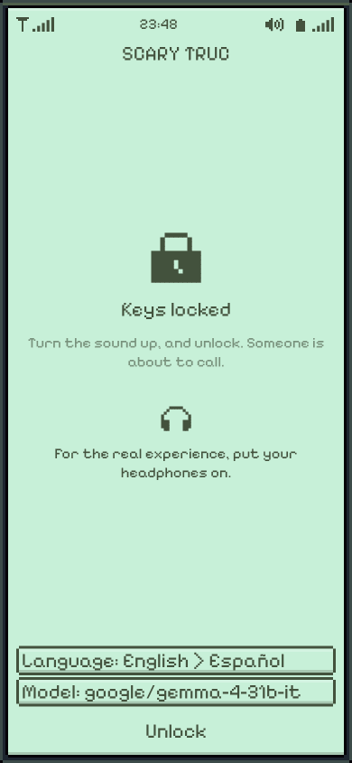

# Scary Truc

> *Don't trust the voice on the phone.*
>
> — scratched into a wall of The Tape

It's past midnight and your phone is ringing. **Unknown number.**

You answer, and someone is whispering on the line, too fast, too close. They woke up somewhere
they shouldn't be. They don't know how they got there. The others who came with them are gone,
and out of every number in that phone, you're the one who picked up.

You can't see where they are. You have their voice, a battery that is running out, and a notebook
where you draw the maze from what they tell you. The pencil fades.

Something else is down there with them. It has no eyes. It finds you by how you sound. So you
talk them through it, *left, right, hide, don't breathe*, and you keep them calm, because fear
is loud.

**[Answer the phone](https://deeptelar.github.io/scary-truc/)**. Headphones on, lights off, and say
it out loud. It plays on a phone.

<p align="center">
  
</p>

## Six calls

Each is a maze drawn by hand after a horror film. Slide through the cards and answer any of them.
When the line goes dead, you learn how many steps they were from the way out.

| Call | Where they wake up | What's written on the wall |
|---|---|---|
| **The Cave**, after *The Descent* | "Wet rock everywhere, so tight, and water dripping somewhere." | *We came down six. I'm the last. It can't see. It hears.* |
| **The Woods**, after *The Blair Witch Project* | "Trees so close together they're like walls, and the branches creak." | *We walked south all day and came back to the same log. Three times.* |
| **The Cube**, after *Cube* | "Square, metal, a hatch in every wall, and everything hums." | *Every room looks like the last. Some kill.* |
| **The Tape**, after *Ring* | "Old stone, wet, round like the inside of a well. There's a TV on the floor, showing static." | *Seven days, it said. It always calls back.* |
| **The Hedge**, after *The Shining* | "Frozen hedges taller than me, and a huge hotel far away with every window dark." | *The hedges move when the clock strikes. Follow the cold, not your map.* |
| **The Ship**, after *Alien* | "Pipes, steam, and a red alarm light turning somewhere." | *It's awake. It's always awake.* |

## What the builder of the mazes wants you to know

**They see. You don't.** Every way is said from where *they* face, so their left is not always
your left.

**Fear is loud.** A frightened caller stumbles and refuses, and sometimes runs down a
corridor you never chose. A kind voice steadies them; a cruel one doesn't.

**It hunts by sound.** They call it the Hollow. You'll only ever hear it: slow, wet footsteps,
breathing, and sometimes a whisper on the line that is meant for you. Some nights it sleeps,
until something wakes it. A caller crouched in the dark and holding their breath may hear it walk
right past.

**Not every door is a door.** Three things kill down there. A floor that turns black and wet
and swallows the light. A warm door that moves a little, like it's breathing. A tall mirror where
their reflection isn't holding a phone. The ones who came before left notes about them.

**Midnight comes.** A bell tolls, the walls move, the screen goes dark, and the place starts to
sound like something else. What's in your notebook is only a memory now.

**The light is running out.** Every step and every word costs battery. Things were left in the
dead ends for whoever came next: a spare battery, a road flare, a stone that makes its noise where
it lands, not where it was thrown from.

**Listen when they say they've been here before.** Go in circles and they'll notice, and they'll
tell you what they haven't tried.

**Leave a mark.** Corridors look alike. A number scratched into a wall stays when the pencil
fades.

**Listen to what they think out loud.** Their fear isn't all they say. A stone on the floor, a
strange draft, walls that have started to move: they'll wonder about it. They never tell you what
to do.

**Hanging up is giving up.** The **End** key is in the corner. Nobody gets out alone.

## Talking to them

It's a phone call, so it's best played out loud: tap **Talk** and speak, and what you said goes when
you pause. You can type instead. (Speech recognition is the browser's own, and most browsers do it
on their maker's servers; the page only receives the text.)

There are no options to pick. They ask, and you answer, the way you'd talk to a stranger who is
terrified. Gemma reads how you said it as well as where you said to go. A kind word costs a turn,
and something is still walking, so say both at once.

Tell them two things in one breath, "take it and go back" or "go right and hide", and they do both,
one after the other, and it costs two turns. If they can't, they say so: a stone that isn't there
doesn't end up in their pocket because you asked for it.

The same kind words wear thin while all is quiet, and no one down there is ever really calm. Once
a call, when they are already panicking, a kind word and nothing else is a breather, and no turn at
all: nothing moves, and your time starts again. Joke with them and they'll wonder who you really
are. Go quiet and they'll beg you to say something, then choose for themselves. A bare word works
when there's no time: "left", "hide", "take it", or the arrow keys.

They speak English or Spanish: the language of your browser at first, or whichever you pick on the
lock screen. Talk to them in the wrong one and you'll get *"I don't understand what you're
saying."*

Whatever you say, they stay who they are: a scared person in a maze, with no idea what an AI is,
who can't call anyone else and doesn't know more than they can see.

## Playing it

**<https://deeptelar.github.io/scary-truc/>**, in a browser or on a phone. Under the lock screen
you can set the language and the model.

Without a model, the caller knows only a few words (left, right, ahead, back, stay, hide, mark,
take, use), one at a time. With one, they understand you in your own words: Gemma 4 on
[OpenRouter](https://openrouter.ai) with your own key, or your own [Ollama](https://ollama.com). The
key stays in your browser and goes from it straight to the server. A friend's proxy works too: its address, and your token as the
key.

On the desktop, run `./gradlew run`, or `./gradlew run --args='--call ship'`. With Ollama running
and `gemma4:12b` pulled, Gemma plays the caller; add `--no-gemma` to play without it.

### Play tests

**Model > Share a try-out** makes a link for testers, with no setup on their side: your model and
key, locked with a secret word you tell them apart from the link. It sits after the `#`, which no
server ever sees, and the page forgets the key after the days you choose. The lock stops a forwarded
link and no more, so give the key a credit limit and delete it when the test ends.

The phone keeps a log of every call: what the player said, what the caller understood and answered,
and how the call stood after each turn (battery, panic, trust, how far the Hollow was, walks that
found nothing new). **Menu > Export play log**, or **Log** at the end of a call, hands it over as a
text file. It stays on the device until then, holds what the player said or typed, and never holds
a key.

Each call that ends is also kept on its own, and **Menu > Statistics** counts them, just for fun:
how many got out, what took the others, how many steps from the way out, and how often panic was
to blame (they ran into it, or the Hollow heard their fear). The calls in an older log are read in
the first time.

It also traces what goes on underneath: the build and the browser, every call to the model with its
time and tokens, and every fault with its stack, even a crash, which the next visit finds.

## Behind the wall

A call is a [Telar](https://github.com/deeptelar/telar) graph that pauses for your words:

| Node | What it does |
|---|---|
| `speak` | Gemma voices the caller, from the facts `walk` gave it and nothing else |
| `listen` | Gemma reads your words: the way you said to go, and how they made the caller feel |
| `walk` | The maze answers in code: the caller obeys, refuses or bolts, walks a corridor, the Hollow hunts, for each of two things said at once |
| `whisper` | When the Hollow is close, it speaks on the line, to you |

Gemma never decides what is true. The maze does, so the caller can't invent a door that isn't
there, can't be talked out of a wall that is, and can't claim a stone they never picked up.

## The challenge

Built for the [DEV Hacktoberfest Open-Source AI Challenge, week 4: Ghost in the Machine](https://dev.to/challenges/hacktoberfest-week4-2026-10-26), with [Gemma 4](https://ai.google.dev/gemma) by Google.

## Build

```bash
./gradlew jvmTest                      # the tests
./gradlew run                          # the desktop game
./gradlew wasmJsBrowserDistribution    # the page, in build/dist/wasmJs/productionExecutable
```

Pixelify Sans is under the SIL Open Font License ([licenses/](licenses/PixelifySans-OFL.txt)).

The sounds are cut from sound effects on [Pixabay](https://pixabay.com/sound-effects/):

- Dark ambient loop, on the lock screen and the guide, and after midnight: [freesound_community](https://pixabay.com/users/freesound_community-46691455/?utm_source=link-attribution&utm_medium=referral&utm_campaign=music&utm_content=31306)
- Old mine ambience in The Cave: [Joel Fazhari](https://pixabay.com/users/joelfazhari-16466931/?utm_source=link-attribution&utm_medium=referral&utm_campaign=music&utm_content=200677)
- Night crickets in The Woods: [freesound_community](https://pixabay.com/users/freesound_community-46691455/?utm_source=link-attribution&utm_medium=referral&utm_campaign=music&utm_content=7015)
- Industrial hum in The Cube: [DRAGON-STUDIO](https://pixabay.com/users/dragon-studio-38165424/?utm_source=link-attribution&utm_medium=referral&utm_campaign=music&utm_content=482882)
- Creepy vocal ambience in The Tape: [freesound_community](https://pixabay.com/users/freesound_community-46691455/?utm_source=link-attribution&utm_medium=referral&utm_campaign=music&utm_content=6074)
- Winter and cemetery wind in The Hedge: [DRAGON-STUDIO](https://pixabay.com/users/dragon-studio-38165424/?utm_source=link-attribution&utm_medium=referral&utm_campaign=music&utm_content=402331) and [DRAGON-STUDIO](https://pixabay.com/users/dragon-studio-38165424/?utm_source=link-attribution&utm_medium=referral&utm_campaign=music&utm_content=467488)
- Spaceship hum and ambience in The Ship: [Paweł Spychała](https://pixabay.com/users/audiopapkin-14728698/?utm_source=link-attribution&utm_medium=referral&utm_campaign=music&utm_content=296518) and [Iris,Helen,silvy](https://pixabay.com/users/placidplace-25572496/?utm_source=link-attribution&utm_medium=referral&utm_campaign=music&utm_content=21420)
- Metallic ambience after midnight: [Jurij](https://pixabay.com/users/soundreality-31074404/?utm_source=link-attribution&utm_medium=referral&utm_campaign=music&utm_content=593615)
- Phone ring: [Andre Gautawa](https://pixabay.com/users/gautawa-47468133/?utm_source=link-attribution&utm_medium=referral&utm_campaign=music&utm_content=272648)
- Picking up: [freesound_community](https://pixabay.com/users/freesound_community-46691455/?utm_source=link-attribution&utm_medium=referral&utm_campaign=music&utm_content=46796)
- Low battery: [u_edtmwfwu7c](https://pixabay.com/users/u_edtmwfwu7c-46613712/?utm_source=link-attribution&utm_medium=referral&utm_campaign=music&utm_content=329310)
- Battery dies: [SoundShelfStudio](https://pixabay.com/users/soundshelfstudio-46480698/?utm_source=link-attribution&utm_medium=referral&utm_campaign=music&utm_content=516361)
- Swapping the battery: [Arunangshu Banerjee](https://pixabay.com/users/arunangshubanerjee-29054022/?utm_source=link-attribution&utm_medium=referral&utm_campaign=music&utm_content=330040)
- Caller's message: [Elio](https://pixabay.com/users/son_duquotidient-44285139/?utm_source=link-attribution&utm_medium=referral&utm_campaign=music&utm_content=391098)
- Footsteps: [KRNBEATZ](https://pixabay.com/users/krnbeatz-52298700/?utm_source=link-attribution&utm_medium=referral&utm_campaign=music&utm_content=422586)
- Walking into a wall: [freesound_community](https://pixabay.com/users/freesound_community-46691455/?utm_source=link-attribution&utm_medium=referral&utm_campaign=music&utm_content=48113) and [freesound_community](https://pixabay.com/users/freesound_community-46691455/?utm_source=link-attribution&utm_medium=referral&utm_campaign=music&utm_content=48114)
- Crouching to hide: [freesound_community](https://pixabay.com/users/freesound_community-46691455/?utm_source=link-attribution&utm_medium=referral&utm_campaign=music&utm_content=30053) and [freesound_community](https://pixabay.com/users/freesound_community-46691455/?utm_source=link-attribution&utm_medium=referral&utm_campaign=music&utm_content=69380)
- Scratching a mark: [freesound_community](https://pixabay.com/users/freesound_community-46691455/?utm_source=link-attribution&utm_medium=referral&utm_campaign=music&utm_content=32394)
- Picking something up: [Sarthak Raj](https://pixabay.com/users/sarthakraj_308-46659583/?utm_source=link-attribution&utm_medium=referral&utm_campaign=music&utm_content=308450)
- Heartbeat: [freesound_community](https://pixabay.com/users/freesound_community-46691455/?utm_source=link-attribution&utm_medium=referral&utm_campaign=music&utm_content=96879)
- Draft near the way out: [Jurij](https://pixabay.com/users/soundreality-31074404/?utm_source=link-attribution&utm_medium=referral&utm_campaign=music&utm_content=457957)
- Running in a panic: [freesound_community](https://pixabay.com/users/freesound_community-46691455/?utm_source=link-attribution&utm_medium=referral&utm_campaign=music&utm_content=47595)
- Flare: [freesound_community](https://pixabay.com/users/freesound_community-46691455/?utm_source=link-attribution&utm_medium=referral&utm_campaign=music&utm_content=19895)
- Thrown stone: [LoLa Joy](https://pixabay.com/users/u_xg7ssi08yr-48039129/?utm_source=link-attribution&utm_medium=referral&utm_campaign=music&utm_content=572428)
- Radio interference: [freesound_community](https://pixabay.com/users/freesound_community-46691455/?utm_source=link-attribution&utm_medium=referral&utm_campaign=music&utm_content=7122)
- The Hollow waking: [DRAGON-STUDIO](https://pixabay.com/users/dragon-studio-38165424/?utm_source=link-attribution&utm_medium=referral&utm_campaign=music&utm_content=472380)
- The Hollow howling far away: [DRAGON-STUDIO](https://pixabay.com/users/dragon-studio-38165424/?utm_source=link-attribution&utm_medium=referral&utm_campaign=music&utm_content=376892)
- The Hollow's breath: [Aman Kumar](https://pixabay.com/users/tanweraman-29554143/?utm_source=link-attribution&utm_medium=referral&utm_campaign=music&utm_content=392363)
- The Hollow sniffing at a hidden caller: [AlesiaDavina](https://pixabay.com/users/alesiadavina-32608554/?utm_source=link-attribution&utm_medium=referral&utm_campaign=music&utm_content=541144)
- Jump scare: [Gavin Mogensen](https://pixabay.com/users/fronbondi_skegs-23154649/?utm_source=link-attribution&utm_medium=referral&utm_campaign=music&utm_content=503610)
- Midnight bell: [freesound_community](https://pixabay.com/users/freesound_community-46691455/?utm_source=link-attribution&utm_medium=referral&utm_campaign=music&utm_content=33827)
- Walls moving at midnight: [freesound_community](https://pixabay.com/users/freesound_community-46691455/?utm_source=link-attribution&utm_medium=referral&utm_campaign=music&utm_content=101019)
- Midnight horn: [Alexander Jauk](https://pixabay.com/users/alex_jauk-16800354/?utm_source=link-attribution&utm_medium=referral&utm_campaign=music&utm_content=228913)
- Woman's screams: [Dilip](https://pixabay.com/users/virtual_vibes-51361309/?utm_source=link-attribution&utm_medium=referral&utm_campaign=music&utm_content=379381) and [Dilip](https://pixabay.com/users/virtual_vibes-51361309/?utm_source=link-attribution&utm_medium=referral&utm_campaign=music&utm_content=379382)
- Man's screams: [Official Profile](https://pixabay.com/users/universfield-28281460/?utm_source=link-attribution&utm_medium=referral&utm_campaign=music&utm_content=123078) and [Hiran Vinodya](https://pixabay.com/users/vinodadora-30315691/?utm_source=link-attribution&utm_medium=referral&utm_campaign=music&utm_content=128357)
- Falling into the pit: [freesound_community](https://pixabay.com/users/freesound_community-46691455/?utm_source=link-attribution&utm_medium=referral&utm_campaign=music&utm_content=71789) and [Official Profile](https://pixabay.com/users/universfield-28281460/?utm_source=link-attribution&utm_medium=referral&utm_campaign=music&utm_content=326183)
- The door that is a mouth: [freesound_community](https://pixabay.com/users/freesound_community-46691455/?utm_source=link-attribution&utm_medium=referral&utm_campaign=music&utm_content=104392)
- The mirror: [DRAGON-STUDIO](https://pixabay.com/users/dragon-studio-38165424/?utm_source=link-attribution&utm_medium=referral&utm_campaign=music&utm_content=504035)
- The Hollow's roar: [DRAGON-STUDIO](https://pixabay.com/users/dragon-studio-38165424/?utm_source=link-attribution&utm_medium=referral&utm_campaign=music&utm_content=364481)
- Line goes dead: [freesound_community](https://pixabay.com/users/freesound_community-46691455/?utm_source=link-attribution&utm_medium=referral&utm_campaign=music&utm_content=103906)
- Door to the way out: [freesound_community](https://pixabay.com/users/freesound_community-46691455/?utm_source=link-attribution&utm_medium=referral&utm_campaign=music&utm_content=37271)
- Way out: [Neo Theone](https://pixabay.com/users/mrstokes302-48032194/?utm_source=link-attribution&utm_medium=referral&utm_campaign=music&utm_content=423626)
